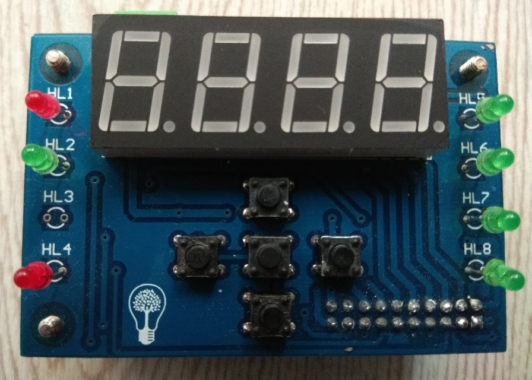
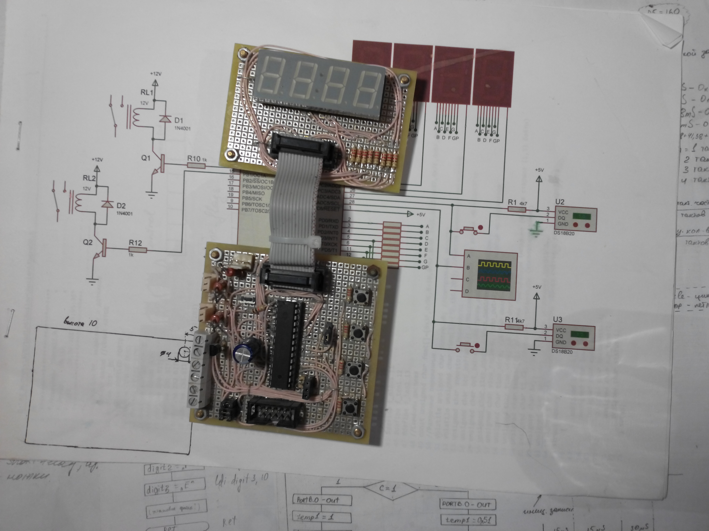

# Boiler project.  
***Note:*** *One of my first projects in C language. It started in 2016.
The previous code was abandoned, and the project was recommenced in 2026.*  

##### Current view

##### First implementation view.

#### The main features of the project.  
The boller device allows you to control two heating elements, with
a capacity of up to 2 kW. The boiler is built on the ATMega16A controller,
uses two DS18B20 sensors to control the temperature in each of the heating tanks.
A seven-segment indicator is used to indicate the current temperature.
Eight LEDs act as additional indication. The boiler is controlled using five buttons.  

#### Build

Build the AVR firmware with AVR-GCC and GNU Make using `make`.
Run host tests with `make test` (requires a host C compiler, Python 3 and Git).

GitHub Actions runs both checks for pull requests and pushes to `development`,
`main`, or `master`, and stores the firmware images, map and `VERSION` as an
artifact. Hardware behavior still requires testing on the board.

#### Version and pull requests

`VERSION` contains the project version (`MAJOR.MINOR.PATCH`), initially `0.1.0`.
It is release metadata, not embedded in the firmware. After each push to
`development` (including PR merges), Actions increments the patch component
once per push, regardless of its commit count, and runs `make_release.py`
to synchronize `VERSION` and the `@version` headers of Git-tracked project-owned
C/C++ files in `inc`, `src`, `bsp` and `tests`. Files are selected by the
`@authors Anton Chernov` header; `lib`, `OldCode` and EEPROM format versions
are not changed.

For manual releases, run `python3 make_release.py 0.2.0` with the desired version.
By default this verifies written content, rebuilds firmware and runs host tests;
errors restore the original files. `--skip-build` explicitly skips build/test
verification, as used by the automatic workflow. CI runs separately;
the automatic bump does not wait for its result. Interrupted runs
may leave `.release.bak` files; restore or resolve them before retrying.
The script does not commit, tag or push changes.

A `[skip ci]` marker in any pushed commit message suppresses the automatic bump.
For PRs merged by that push, their titles and bodies (including the automatic
commit summary) are also checked via the GitHub API. API failures stop the
workflow rather than bypassing this check. Version commits also use `[skip ci]`
to avoid redundant CI and version runs. Repeated runs for the same pushed
commit do not increment the version again.
Commit selection uses the push event payload, so rewritten history does not
require the previous branch-tip commit to remain available.

The version workflow needs permission to push to `development`. The default
`GITHUB_TOKEN` works when repository rules allow it; otherwise configure the
optional `VERSION_BUMP_TOKEN` secret with repository contents write access
and allow its owner to push under the branch rules. The workflow's
`GITHUB_TOKEN` also needs pull-request read access for the skip check.
The commit-summary workflow needs pull-request write access and updates only
the marked `Commits` section, preserving the rest of the PR description.

#### Documentation

- [Specification](SPECIFICATION.md) - technical requirements.
- [History](HISTORY.md) - completed work, changes, and engineering decisions.
- [Changelog](CHANGELOG.md) - release-oriented changes.
